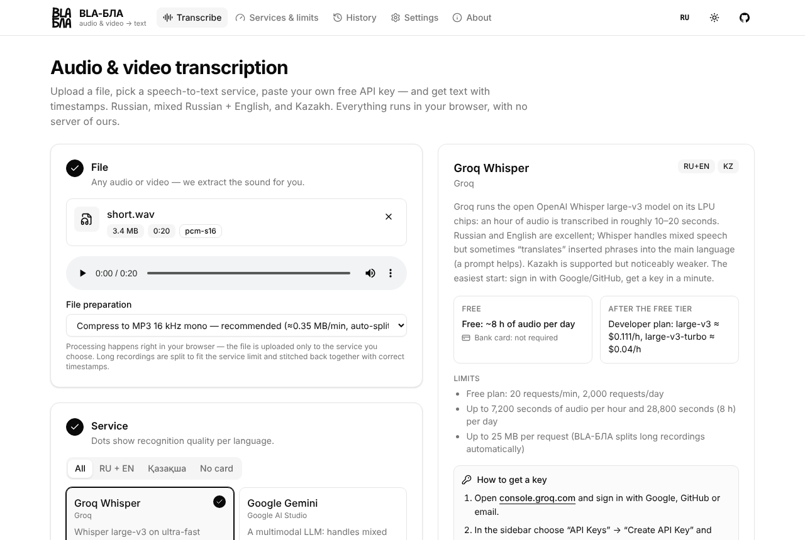
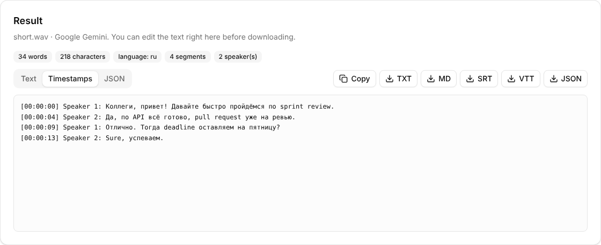

<p align="center">
  
</p>

<h1 align="center">BLA-БЛА</h1>

<p align="center">
  <b>Transcribe any audio or video in your browser with your own free API keys.</b><br>
  11 speech-to-text services, one interface. Tuned for mixed Russian + English speech and Kazakh.
</p>

<p align="center">
  <a href="https://ehroz1.github.io/bla-bla-text/"><b>Open the app →</b></a>
  ·
  <a href="https://ehroz1.github.io/bla-bla-text/bla-bla.html">Single-file version</a>
  ·
  <a href="README.ru.md">Читать на русском</a>
</p>

<p align="center">
  <a href="https://github.com/ehroz1/bla-bla-text/actions/workflows/ci.yml"></a>
  <a href="https://github.com/ehroz1/bla-bla-text/actions/workflows/pages.yml"></a>
</p>

<p align="center">
  
</p>

The interface is available in **English and Russian**: use the **EN / RU** button in the header. By default it follows your browser language.

## Why

Speech-to-text services are good, but each has its own sign-up flow, limits, upload rules and response format. Comparing them, or simply finding a free one that handles a meeting where people switch between Russian and English mid-sentence, means juggling docs and curl commands.

BLA-БЛА puts 11 services behind one page:

- **Bring your own key.** Most supported services have a free tier or sign-up credits. The app shows, for each service, how to get a key, step by step.
- **No backend.** Audio is prepared in the browser and sent straight to the service you pick. Keys stay in your browser's `localStorage`.
- **Any media file.** Video is fine, only the audio track is used. Long recordings are split to fit each service's upload limit and stitched back with correct timestamps.

## Features

- **Upload anything the browser can read**: mp3, m4a, wav, ogg/opus, flac, mp4, mov, webm, mkv…
- **In-browser audio preparation** with [mediabunny](https://mediabunny.dev) + WebCodecs: mono 16 kHz MP3 at ≈0.35 MB/min (or lossless WAV, or the original file). If the browser can't decode a codec, the original file is sent as-is when it fits the limit.
- **Automatic chunking** to each provider's size and duration limits, with merged text and shifted timestamps.
- **11 providers** with per-language quality hints (RU / EN / RU+EN / KZ), free-tier details, limits, pricing and key instructions.
- **Provider settings**: language, model, speaker diarization, custom vocabulary or prompt (depending on what each API supports).
- **Usage and limits**: a "check key & balance" button calls the provider where its API allows it (see table). A local counter tracks minutes transcribed today and this month.
- **Results**: edit the text in place, copy it, or download TXT, Markdown, SRT, VTT or JSON. The last 30 transcripts stay in local history.
- **CORS proxy option** for providers that block direct browser calls: a tiny Cloudflare Worker you deploy yourself.
- **English and Russian interface**, light and dark theme, mobile layout, shadcn/ui-style design.

<p align="center">
  
  <br><sub>Result view. The transcript shown is a sample response from the test suite's mocked API, not real service output.</sub>
</p>

## Supported services

| Service | RU+EN mix | Kazakh | Free access | Card | Direct from browser | In-app key / usage check |
|---|:-:|:-:|---|---|---|---|
| [Groq Whisper](https://console.groq.com/keys) | ●●○ | ●○○ | ~8 h of audio per day | no | yes | key check |
| [Google Gemini](https://aistudio.google.com/app/apikey) | ●●● | ●●○ | daily request quota | no | yes | key + available models |
| [ElevenLabs Scribe](https://elevenlabs.io/app/settings/api-keys) | ●●● | ●●● | 10,000 credits / month | no | yes | credit balance |
| [Speechmatics](https://portal.speechmatics.com/settings/api-keys) | ●●● | — | $100 one-time | no | not verified | hours used this month |
| [AssemblyAI](https://www.assemblyai.com/dashboard/api-keys) | ●●○ | — | $50 one-time | no | not verified | transcripts this month |
| [Gladia](https://app.gladia.io/apikeys) | ●●● | ●●○ | €50 one-time | no | not verified | key check |
| [Mistral Voxtral](https://console.mistral.ai/api-keys) | ●●○ | — | Free plan | no | not verified | key check |
| [Deepgram Nova-3](https://console.deepgram.com) | ●●● | — | $200 one-time | no | needs proxy | project balance |
| [Soniox](https://console.soniox.com) | ●●● | ●●● | paid, ~$0.10/h | yes | not verified | key check |
| [Yandex SpeechKit](https://console.yandex.cloud) | ●●○ | ●●● | Yandex Cloud starter grant | yes | needs proxy | — |
| [OpenAI](https://platform.openai.com/api-keys) | ●●● | ●○○ | paid only | yes | yes | key check |

Quality dots are an editorial estimate based on vendor documentation and public benchmarks, not measurements by this project. Free tiers change often; the in-app cards and [docs/stt-apis.md](docs/stt-apis.md) (in Russian) list sources and what could not be verified.

**Good starting points:**

- **Fastest free start:** Groq. A key takes a minute and no card is needed.
- **Mixed Russian + English:** ElevenLabs Scribe, Gemini or Speechmatics (Melia-1 model).
- **Kazakh:** ElevenLabs Scribe or Gemini (free). Soniox and Yandex SpeechKit cost money or need a proxy.

## Quick start (use it)

1. Open **https://ehroz1.github.io/bla-bla-text/**.
2. Drop an audio or video file onto the first card.
3. Pick a service. Its card shows how to get a free key, with links.
4. Paste the key. It is saved in this browser only.
5. Adjust settings if needed and press **Transcribe with …**.

Prefer offline? Download [`bla-bla.html`](https://ehroz1.github.io/bla-bla-text/bla-bla.html). It's the whole app in one file and works when opened from disk (the speech APIs still need internet).

## Run locally (develop)

**Prerequisites:** Node.js 22 (the version CI uses) and npm.

```bash
git clone https://github.com/ehroz1/bla-bla-text.git
cd bla-bla-text
npm ci
npm run dev            # http://localhost:5173
```

| Script | What it does |
|---|---|
| `npm run dev` | Vite dev server with hot reload |
| `npm run build` | Type-check and build the static site into `dist/` |
| `npm run build:single` | Build a single self-contained `dist-single/index.html` |
| `npm run preview` | Serve the production build locally |
| `npm run lint` | Lint with [oxlint](https://oxc.rs) |
| `npm run typecheck` | TypeScript project check |
| `npm run test:fixtures` | Generate synthetic test media in `tests/fixtures/` (needs `ffmpeg`) |
| `npm run test:e2e` | End-to-end test of all providers in headless Chromium (build first) |

No environment variables are needed. There is no server and no `.env`.

### Tests

The end-to-end test drives a real Chromium through the whole flow (upload → in-browser compression and chunking → API request → rendered transcript) for all 11 providers. API responses are mocked from each provider's documented format, so **no real keys are used**, and the test can't prove a live API still behaves the same way.

```bash
npx playwright install chromium   # once
npm run test:fixtures             # needs ffmpeg
npm run build
npm run test:e2e                  # or: node tests/e2e.mjs tests/fixtures groq gemini
```

### Deploying your own copy

`.github/workflows/pages.yml` builds and publishes to GitHub Pages on every push to `main`. Enable it once in **Settings → Pages → Source: GitHub Actions**. The output is plain static files, so any static host works.

## CORS proxy (Deepgram, Yandex)

Some APIs refuse requests made directly from a web page. For those, deploy [`proxy/cloudflare-worker.js`](proxy/cloudflare-worker.js) as a free Cloudflare Worker (instructions are in the file and on the app's **Settings** tab), paste its URL into the app, and enable it per service.

> [!WARNING]
> Your API key passes through the proxy. Only use a proxy you deployed yourself. Set `ALLOWED_ORIGIN` in the worker to your site's origin so others can't reuse it.

## Privacy and limitations

- **Where data goes:** the media file goes only to the provider you choose. Keys, settings, history and usage counters live in `localStorage` in your browser. The page also loads its font from Google Fonts.
- **Provider data policies:** some free tiers may use your data for training. The in-app cards point this out for Gemini and Mistral. Check each provider's terms before uploading sensitive recordings.
- **`localStorage` is not a vault:** anyone with access to your browser profile can read stored keys. Use the trash button or **Settings → Erase everything** on shared machines.
- **Browser support:** audio processing relies on WebCodecs, with a Web Audio fallback. Automated tests run in headless Chromium. Other browsers haven't been tested systematically; open-source Chromium builds can't decode AAC (mp4/m4a), in which case the original file is uploaded.
- **Long files take time:** MP3 encoding is CPU-bound. In the test VM, compressing a 40-minute file took about 2.5 minutes.
- **Approximate timestamps:** Gemini is a language model, not a dedicated recognizer, so its timestamps are estimates.
- **Live API behaviour is not tested in CI:** see [Tests](#tests).

## Troubleshooting

| Symptom | Likely cause and fix |
|---|---|
| "The browser could not send the request…" | The provider blocks browser calls (CORS), an ad blocker or VPN interfered, or you're offline. Try the CORS proxy. |
| `401` | Key copied incompletely or revoked. Paste it again. |
| `403` | Key lacks permissions, or the service is unavailable in your region (e.g. ElevenLabs and Gemini in some countries). |
| `429` | Rate limit or quota reached. Wait, or switch provider. |
| Blank page after deploying a fork | GitHub Pages is set to "Deploy from a branch". Switch the source to **GitHub Actions**. |

## Project structure

```
src/
  providers/        one file per speech-to-text service + shared HTTP/segment helpers
  lib/audio.ts      in-browser extraction, compression and chunking (mediabunny)
  lib/run.ts        prepare → transcribe each chunk → merge
  components/       UI (shadcn/ui-style components in components/ui)
  lib/i18n.ts       English/Russian strings: t('ru', 'en') + tx()
proxy/              optional Cloudflare Worker CORS proxy
tests/              Playwright end-to-end test with mocked provider responses
docs/               provider research, public-apis review, README screenshots
```

## Contributing

Bug reports, provider updates (free tiers and models change often) and new providers are welcome. See [CONTRIBUTING.md](CONTRIBUTING.md) for setup, checks and a short guide to adding a provider. For security issues, see [SECURITY.md](SECURITY.md).

## License

No license has been chosen yet. Until one is added, default copyright applies and the code is not licensed for reuse.

---

If BLA-БЛА saves you some time, a ⭐ helps other people find it.
