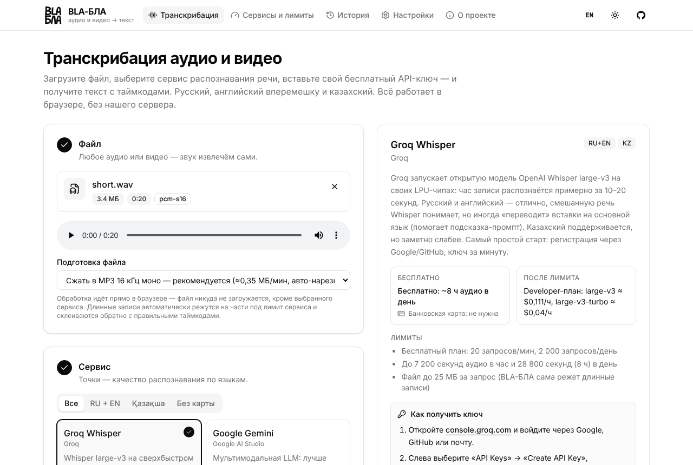
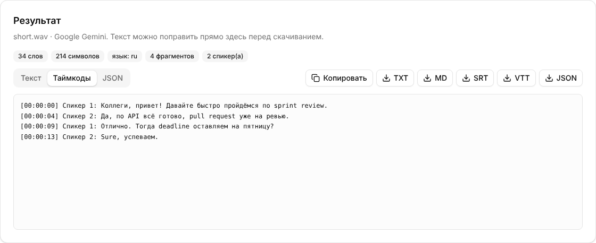

<p align="center"></p>

<h1 align="center">BLA-БЛА</h1>

<p align="center">
  <b>Транскрибация аудио и видео прямо в браузере — со своими бесплатными API-ключами.</b><br>
  11 сервисов распознавания речи в одном окне. Русский с английским вперемешку и казахский.
</p>

<p align="center">
  <a href="https://ehroz1.github.io/bla-bla-text/"><b>Открыть приложение →</b></a>
  ·
  <a href="https://ehroz1.github.io/bla-bla-text/bla-bla.html">Версия одним файлом</a>
  ·
  <a href="README.md">English</a>
</p>

<p align="center">
  
</p>

Загружаете любой медиафайл → выбираете сервис → вставляете **свой API-ключ** (сохраняется в браузере) → настраиваете → получаете текст с таймкодами и спикерами. Своего сервера нет: файл обрабатывается в браузере и уходит напрямую в выбранный сервис.

## Возможности

- **Любой файл**: mp3, m4a, wav, ogg/opus, flac, mp4, mov, webm, mkv… Из видео берётся только звук.
- **Подготовка в браузере** ([mediabunny](https://mediabunny.dev) + WebCodecs): моно 16 кГц в MP3 (≈0,35 МБ/мин), WAV без потерь или исходный файл. Если браузер не умеет декодировать кодек, файл отправляется как есть, если влезает в лимит.
- **Авто-нарезка** длинных записей под лимиты сервиса и склейка результатов с правильными таймкодами.
- **11 сервисов**: у каждого есть описание, оценка качества по языкам (RU / EN / RU+EN / KZ), бесплатный тариф, лимиты, цена и **пошаговая инструкция, где взять ключ**.
- **Лимиты**: кнопка «Проверить ключ и баланс» спрашивает сам сервис, если его API это позволяет (см. таблицу). Плюс локальный счётчик минут за день и за месяц.
- **Настройки сервиса**: язык, модель, спикеры, словарь терминов, подсказки.
- **Результат**: можно отредактировать, скопировать и скачать в TXT, Markdown, SRT, VTT или JSON. История последних 30 расшифровок хранится в браузере.
- **Интерфейс на русском и английском** (кнопка RU / EN в шапке), светлая и тёмная тема, мобильная вёрстка, дизайн в стиле shadcn/ui.

<p align="center">
  
  <br><sub>Экран результата. Текст — образец из подменённого ответа API в тестах, а не реальный результат сервиса.</sub>
</p>

## Сервисы

| Сервис | RU+EN | Казахский | Бесплатно | Карта | Из браузера | Проверка в приложении |
|---|:-:|:-:|---|---|---|---|
| [Groq Whisper](https://console.groq.com/keys) | ●●○ | ●○○ | ~8 ч аудио в день | нет | да | ключ |
| [Google Gemini](https://aistudio.google.com/app/apikey) | ●●● | ●●○ | дневной лимит запросов | нет | да | ключ + доступные модели |
| [ElevenLabs Scribe](https://elevenlabs.io/app/settings/api-keys) | ●●● | ●●● | 10 000 кредитов/мес | нет | да | баланс кредитов |
| [Speechmatics](https://portal.speechmatics.com/settings/api-keys) | ●●● | — | $100 разово | нет | не проверено | часы за месяц |
| [AssemblyAI](https://www.assemblyai.com/dashboard/api-keys) | ●●○ | — | $50 разово | нет | не проверено | расшифровки за месяц |
| [Gladia](https://app.gladia.io/apikeys) | ●●● | ●●○ | €50 разово | нет | не проверено | ключ |
| [Mistral Voxtral](https://console.mistral.ai/api-keys) | ●●○ | — | режим Free | нет | не проверено | ключ |
| [Deepgram Nova-3](https://console.deepgram.com) | ●●● | — | $200 разово | нет | через прокси | баланс проекта |
| [Soniox](https://console.soniox.com) | ●●● | ●●● | платно, ~$0,10/ч | да | не проверено | ключ |
| [Yandex SpeechKit](https://console.yandex.cloud) | ●●○ | ●●● | стартовый грант | да | через прокси | — |
| [OpenAI](https://platform.openai.com/api-keys) | ●●● | ●○○ | только платно | да | да | ключ |

Точки — оценка по документации сервисов и публичным бенчмаркам, а не собственные замеры проекта. Подробности, эндпоинты и источники — в [docs/stt-apis.md](docs/stt-apis.md). Разбор каталога public-apis — в [docs/public-apis-review.md](docs/public-apis-review.md).

**С чего начать:**
- **Быстрее всего бесплатно:** Groq, ключ за минуту без карты.
- **RU+EN вперемешку:** ElevenLabs Scribe, Gemini, Speechmatics Melia-1.
- **Казахский:** бесплатно ElevenLabs и Gemini; платно или через прокси — Soniox и Yandex SpeechKit.

## Локальный запуск

Нужны Node.js 22 (как в CI) и npm.

```bash
git clone https://github.com/ehroz1/bla-bla-text.git
cd bla-bla-text
npm ci
npm run dev            # http://localhost:5173
npm run build          # dist/ — статический сайт
npm run build:single   # dist-single/index.html — один файл, открывается с диска
```

Переменные окружения не нужны.

### Тесты

E2E-тест прогоняет настоящий Chromium через весь путь «файл → сжатие и нарезка → запрос → текст» для всех 11 сервисов. Ответы API подменяются по образцам из документации, поэтому настоящие ключи не нужны. Работу живых API такой тест не проверяет.

```bash
npx playwright install chromium   # один раз
npm run test:fixtures             # нужен ffmpeg
npm run build
npm run test:e2e
```

## CORS-прокси (для Deepgram и Yandex)

Некоторые API не принимают запросы прямо со страницы. Для них есть маленький прокси на бесплатном Cloudflare Worker: [proxy/cloudflare-worker.js](proxy/cloudflare-worker.js). Инструкция — в самом файле и во вкладке «Настройки». Используйте **только свой** прокси: через него проходит ваш ключ. Укажите в нём `ALLOWED_ORIGIN`, чтобы прокси нельзя было использовать с чужих сайтов.

## Приватность и ограничения

- Файл отправляется только в выбранный сервис. Ключи, настройки, история и счётчики хранятся в `localStorage` браузера. Шрифт страницы загружается с Google Fonts.
- На бесплатных тарифах некоторые сервисы (например, Gemini и Mistral Free) могут использовать данные для обучения.
- `localStorage` — не сейф: на общем компьютере удаляйте ключи (кнопка с корзиной или «Настройки → Стереть всё»).
- Автотесты идут в headless Chromium; остальные браузеры систематически не проверялись. Сжатие длинных файлов занимает время: в тестовой виртуалке 40 минут записи сжимались примерно 2,5 минуты.
- У Gemini таймкоды приблизительные: это языковая модель, а не классический распознаватель.

## Участие

Сообщения об ошибках, обновления тарифов и новые сервисы приветствуются — см. [CONTRIBUTING.md](CONTRIBUTING.md). Об уязвимостях — [SECURITY.md](SECURITY.md).

## Лицензия

Лицензия пока не выбрана. Пока её нет, действует стандартное авторское право, и код не лицензирован для повторного использования.
